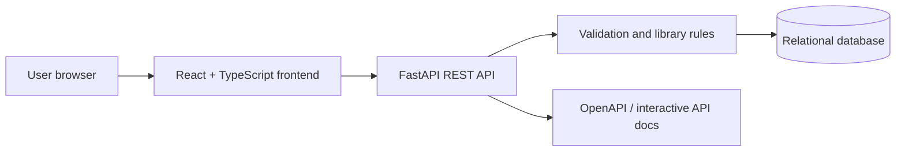
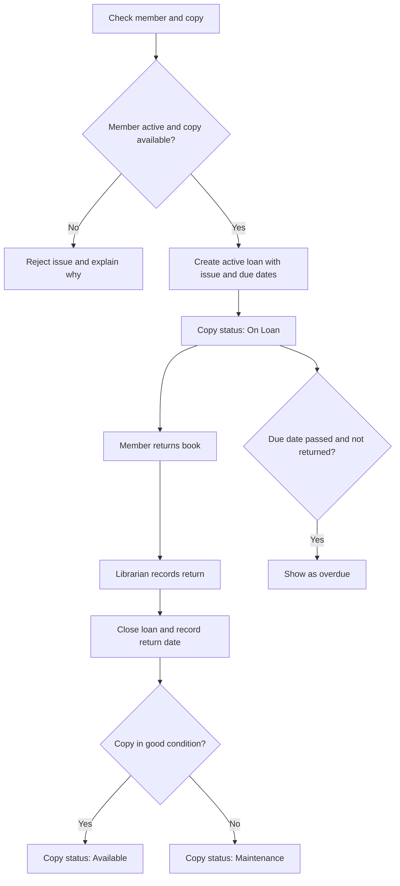

# Software Requirements Specification (SRS) — Library Management System

| Field | Value |
|---|---|
| Product | Library Management System |
| Version | MVP + Beta + Future Phase |
| Status | Draft baseline |
| Related documents | `PRD.md`, `TDD.md` |

This document defines observable system behavior and how it will be checked. Requirements are grouped by release so the MVP remains small while the Beta adds secure multi-user workflows.

## 1. Introduction

### 1.1 Purpose

Specify the requirements for catalogue and circulation management first, then authenticated member service, roles, administrative tools, and a possible future payment feature.

### 1.2 Scope by release

| Release | Scope |
|---|---|
| MVP | Books, copies, member records, issue/return, due dates, overdue list, REST API, and basic React interface. Development/demo use; authentication is not yet complete. |
| Beta | Authentication, RBAC, private member data, borrow requests, staff workflows, admin controls, deployment, and security hardening. |
| Future Phase | Optional fine records and online payments for approved charges. No payment processing in MVP or Beta. |

### 1.3 Definitions

| Term | Meaning |
|---|---|
| Book | A catalogue record describing a title/work. |
| Book copy | One physical copy of a book that can be issued independently. |
| Loan | A record that a copy has been issued to a member and has a due date. |
| Borrow request | A Member's request to borrow a book; available in Beta. |
| RBAC | Role-Based Access Control: permissions depend on the user's role. |
| Member subtype | Student or Teacher classification within the Member role. |
| Overdue loan | An active loan whose due date has passed. |
| Fine record | An optional record of a charge imposed by library policy; Future Phase unless policy says otherwise. |
| Payment transaction | Provider-confirmed money transaction for a charge; Future Phase only. |

## 2. Overall description

### 2.1 System context

The browser communicates with the backend API. The backend is responsible for validation, circulation rules, authentication, authorization, and database changes. The frontend must not be treated as the security boundary.

### 2.2 User classes and roles

| Role | Release | Main permissions |
|---|---|---|
| Unauthenticated development operator | MVP | Can use local demo screens/API; not suitable for public production access |
| Member | Beta | Browse books, submit/cancel eligible requests, view own profile and loan history |
| Librarian | Beta | Manage catalogue and copies, review requests, issue/return books, view overdue records |
| Admin | Beta | Manage accounts and roles, configure borrowing rules, view operational reports |

Student and Teacher are Member subtypes. They may have different limits when configured, but they do not get separate top-level roles.

### 2.3 Constraints and assumptions

- Backend routes use a consistent `/api` prefix and JSON request/response bodies.
- The database technology is finalized in the TDD; the production database must support persistent records and relational constraints.
- MVP is a local/demo baseline and does not have complete account authorization.
- The Beta must enforce permissions in the API on every protected request.
- Payment-provider behavior and fine rules are not requirements for MVP or Beta.

## 3. Functional requirements

### 3.1 Catalogue and copies — MVP

| ID | Requirement | Priority |
|---|---|---|
| FR-01 | The system shall create a book record with required title and optional author, ISBN/identifier, publisher, category, and description. | Must |
| FR-02 | The system shall list and view book records and allow search by title, author, or identifier when search is implemented. | Must |
| FR-03 | The system shall update catalogue metadata and archive a record without destroying historical loan references. | Must |
| FR-04 | The system shall create and view individual copies with unique copy codes. | Must |
| FR-05 | The system shall track copy status, including Available, On Loan, and Unavailable/Maintenance. | Must |
| FR-06 | The system shall prevent an unavailable or already loaned copy from being issued. | Must |

### 3.2 Members and circulation — MVP

| ID | Requirement | Priority |
|---|---|---|
| FR-07 | The system shall create, view, update, and deactivate a Member record with member subtype Student or Teacher. | Must |
| FR-08 | The system shall issue an available copy to an active member and store issue date, due date, copy, member, and loan status. | Must |
| FR-09 | The system shall record a return, store the return date, close the loan, and update copy status. | Must |
| FR-10 | The system shall list active, returned, and overdue loans. | Must |
| FR-11 | An active loan shall be considered overdue when its due date has passed and it has not been returned. | Must |
| FR-12 | The API shall validate input and use consistent status codes and error messages for invalid or missing data. | Must |
| FR-13 | The API shall expose a health endpoint and interactive API documentation. | Should |

### 3.3 Authentication and profile — Beta

| ID | Requirement | Priority |
|---|---|---|
| FR-14 | The system shall authenticate a registered account before granting access to protected functions. | Must |
| FR-15 | The system shall support logout and invalidate or expire the session according to the selected authentication design. | Must |
| FR-16 | The system shall associate a Member account with the correct Member profile. | Must |
| FR-17 | A Member shall be able to view their own profile, current loans, due dates, and borrowing history. | Must |
| FR-18 | The system shall prevent a Member from reading or modifying another Member's private records. | Must |

### 3.4 Role-based access and requests — Beta

| ID | Requirement | Priority |
|---|---|---|
| FR-19 | The system shall implement exactly three top-level roles: Member, Librarian, and Admin. | Must |
| FR-20 | The backend shall authorize each protected endpoint based on role, ownership, and workflow state. | Must |
| FR-21 | A Member shall be able to submit and cancel an eligible pending borrow request. | Must |
| FR-22 | A Librarian shall be able to approve or reject a pending request and record the decision. | Must |
| FR-23 | A Librarian shall be able to issue and return books and manage copy status. | Must |
| FR-24 | An Admin shall be able to create/deactivate accounts and assign permitted roles. | Must |
| FR-25 | An Admin shall be able to configure borrowing limits and loan duration after the policy values are confirmed. | Should |
| FR-26 | Authorized staff shall be able to view basic inventory, active loan, return, and overdue summaries. | Should |
| FR-27 | The system shall record the actor and timestamp for important actions such as issue, return, role change, and request decision. | Should |

### 3.5 Future Phase — fine and payment records

| ID | Requirement | Priority |
|---|---|---|
| FR-28 | If an approved fine policy is adopted, the system may record the fine amount, reason, related loan, and manual adjustment history. | Future |
| FR-29 | If online payments are enabled, the system shall redirect the Member to a trusted hosted payment provider for an approved outstanding charge. | Future |
| FR-30 | The system shall mark a transaction as successful only after verifying a trusted provider callback or server-side status check. | Future |
| FR-31 | The system shall record transaction reference, amount, currency, status, and timestamps and provide a confirmation/receipt. | Future |
| FR-32 | The system shall not store raw card numbers, card security codes, banking passwords, or provider secrets in the frontend or source repository. | Future |
| FR-33 | Duplicate or repeated provider callbacks shall not create duplicate successful payment records. | Future |

### 3.6 Validation rules

| Field | Rule | Release |
|---|---|---|
| Book title | Required; trimmed; 1–200 characters | MVP |
| Book identifier | Unique when supplied | MVP |
| Copy code | Required and unique | MVP |
| Member name | Required; trimmed; 1–100 characters | MVP |
| Member subtype | `student` or `teacher` | MVP |
| Due date | Valid date; cannot precede issue date | MVP |
| Return | Only an active loan may be returned | MVP |
| Account email | Valid, normalized, and unique | Beta |
| Password | Must meet the policy defined by the authentication design | Beta |
| Role | `member`, `librarian`, or `admin` only | Beta |
| Payment amount | Positive decimal using a defined currency and precision | Future |

## 4. Permission matrix — Beta

| Action | Member | Librarian | Admin |
|---|---:|---:|---:|
| Browse catalogue and availability | Yes | Yes | Yes |
| View own profile and loans | Yes | N/A | N/A |
| View another member's private profile/history | No | Only when needed for library operations | Administrative need only; audited |
| Submit/cancel own eligible request | Yes | No | No by default |
| Create/update/archive book catalogue | No | Yes | Yes |
| Manage physical copies | No | Yes | Yes |
| Approve/reject borrow requests | No | Yes | Yes, if policy permits |
| Issue and return copies | No | Yes | Yes, if policy permits |
| View operational overdue/inventory reports | Own overdue records only | Yes | Yes |
| Create/deactivate accounts and assign roles | No | No | Yes |
| Change borrowing policy | No | No | Yes |
| Record or settle future fine records | No by default | If authorized by policy | Yes |
| View payment provider details or secrets | No | No | No; secrets remain in server configuration |

All permissions must be enforced by the backend. Hiding a control in React is not sufficient.

## 5. Circulation workflow and states

Suggested states:

| Entity | States |
|---|---|
| Book copy | Available, On Loan, Unavailable, Maintenance |
| Borrow request (Beta) | Pending, Approved, Rejected, Cancelled, Fulfilled |
| Loan | Active, Returned, Lost (if loss handling is approved) |
| Payment transaction (Future) | Pending, Succeeded, Failed, Cancelled, Refunded (if refunds are supported) |

Overdue is a condition of an active loan, not a replacement for the loan's status.

## 6. Non-functional requirements

| ID | Category | Requirement | Release |
|---|---|---|---|
| NFR-01 | Usability | Forms show clear validation, loading, empty, success, and error states. | MVP |
| NFR-02 | Integrity | A physical copy cannot have two active loans at the same time. | MVP |
| NFR-03 | Persistence | Core records survive application restarts and redeploys in the deployed configuration. | MVP local tests; Beta deployment |
| NFR-04 | Maintainability | UI, API routes, business logic, and data-access code are separated. | MVP |
| NFR-05 | API usability | API routes have request/response schemas and interactive docs. | MVP |
| NFR-06 | Security | Protected endpoints enforce authentication and authorization server-side. | Beta |
| NFR-07 | Privacy | Members cannot access another Member's personal records. | Beta |
| NFR-08 | Credential security | Passwords are hashed; secrets are kept in environment configuration and never committed. | Beta |
| NFR-09 | Error handling | Errors do not expose stack traces, secrets, or unnecessary personal data. | Beta |
| NFR-10 | Auditability | Important circulation and admin actions can be traced to an actor and timestamp. | Beta |
| NFR-11 | Performance | For expected initial usage, common catalogue and loan queries should normally complete within about one second, excluding deployment cold starts. | Beta target |
| NFR-12 | Payment safety | Payment provider secrets and raw payment credentials are never stored by the LMS. | Future |
| NFR-13 | Payment integrity | Payment status is verified server-side and repeated callbacks are handled idempotently. | Future |

## 7. Acceptance criteria

### MVP

**AC-01 — Catalogue:** A valid book can be created and appears in the catalogue. An invalid required title is rejected with a validation message.

**AC-02 — Copies:** A copy has a unique code and a clear status. Duplicate copy codes are rejected.

**AC-03 — Issue:** Issuing an available copy to an active member creates one active loan with issue and due dates and marks the copy On Loan.

**AC-04 — Duplicate issue prevention:** Attempting to issue the same copy again while its current loan is active is rejected and leaves the existing loan unchanged.

**AC-05 — Return:** Returning an active loan stores the return date, closes the loan, and makes the copy Available unless it is marked for maintenance.

**AC-06 — Overdue:** An active loan past its due date appears in the overdue list; a returned loan does not remain overdue.

**AC-07 — Health/docs:** The health endpoint returns a successful status, and API docs describe the available MVP endpoints.

### Beta

**AC-08 — Role enforcement:** Member requests to catalogue-management or circulation-staff endpoints are rejected by the API.

**AC-09 — Member privacy:** Member A cannot retrieve Member B's personal loan history by changing an identifier.

**AC-10 — Borrow request:** A Member can submit an eligible request and a Librarian can approve or reject it; invalid state transitions are rejected.

**AC-11 — Admin controls:** Only an Admin can change account roles or borrowing-policy settings.

**AC-12 — Deployment:** The deployed application uses persistent storage, HTTPS, and environment-based secrets.

### Future Phase

**AC-13 — Provider verification:** A successful browser redirect alone cannot mark a payment as paid; the backend verifies provider status.

**AC-14 — Duplicate callbacks:** Replaying the same provider callback does not create a duplicate successful transaction.

**AC-15 — Safe storage:** Payment records contain provider references and payment metadata only, not raw card or banking credentials.

## 8. Status codes and error behavior

| Case | Expected status |
|---|---:|
| Resource created | `201 Created` |
| Successful read/update | `200 OK` |
| Successful deletion with no response body | `204 No Content` |
| Invalid request data | `422 Unprocessable Entity` |
| Resource not found or private resource is not visible to caller | `404 Not Found` |
| Missing or invalid login credentials | `401 Unauthorized` |
| Authenticated user lacks permission | `403 Forbidden` |
| Duplicate unique record or conflicting circulation action | `409 Conflict` |
| Unexpected server error | `500 Internal Server Error` with generic response |

Exact responses should remain consistent across endpoints. Sensitive implementation details should be logged server-side, not returned to clients.

## 9. Traceability

| Story | Requirements | Release |
|---|---|---|
| US-01 | FR-01–FR-03 | MVP |
| US-02 | FR-04–FR-06 | MVP |
| US-03 | FR-07 | MVP |
| US-04 | FR-08 | MVP |
| US-05 | FR-09 | MVP |
| US-06 | FR-10–FR-11 | MVP |
| US-07 | FR-12–FR-13 | MVP |
| US-08 | FR-14–FR-18 | Beta |
| US-09–US-10 | FR-21–FR-23 | Beta |
| US-11 | FR-19–FR-20, FR-23 | Beta |
| US-12 | FR-24–FR-25 | Beta |
| US-13 | FR-26–FR-27 | Beta |
| US-14 | NFR-06–NFR-11 | Beta |
| US-15–US-17 | FR-28–FR-33, NFR-12–NFR-13 | Future Phase |

## 10. Open decisions

- Confirm loan duration, Student/Teacher limits, renewal rules, and reservation expiry.
- Decide whether a member request reserves a copy or is simply a request until staff approval.
- Confirm how member accounts are created and recovered.
- Select the production database and deployment configuration.
- Decide whether fines exist; if yes, define amount calculation, waiver authority, and dispute process.
- Select payment provider, currency, supported payment methods, refunds, and transaction reconciliation before starting the Future Phase.
