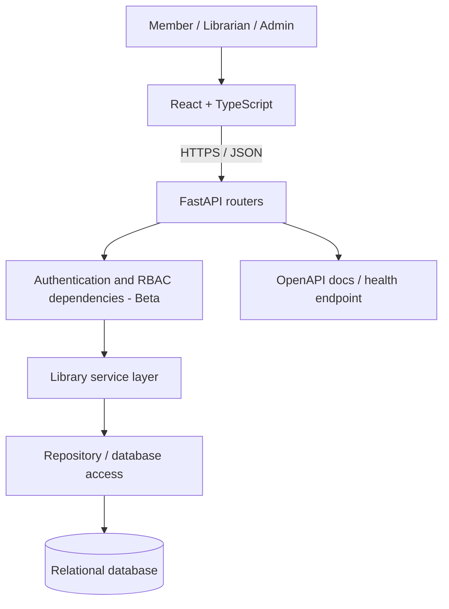
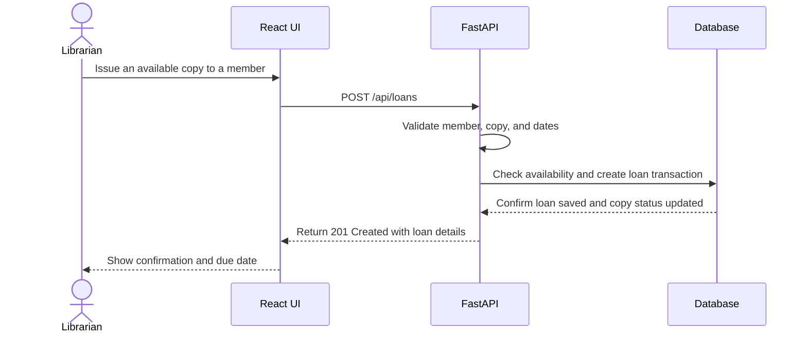
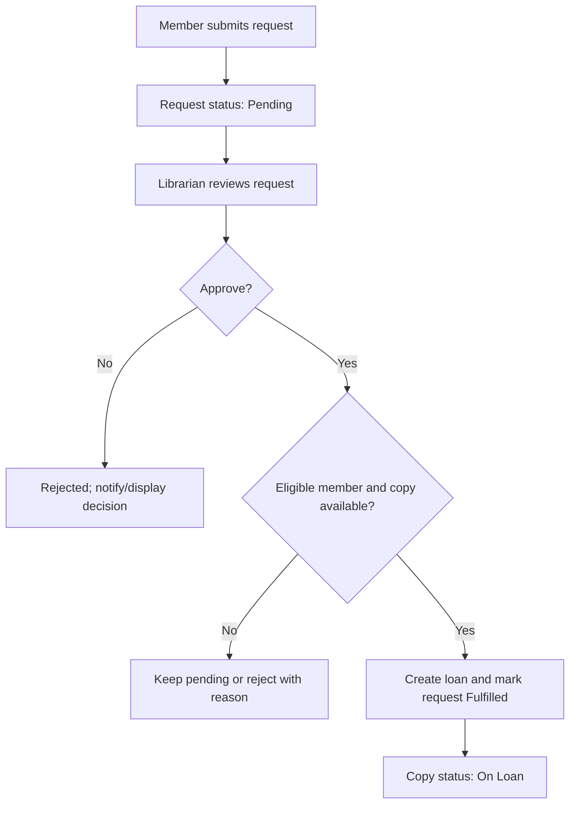
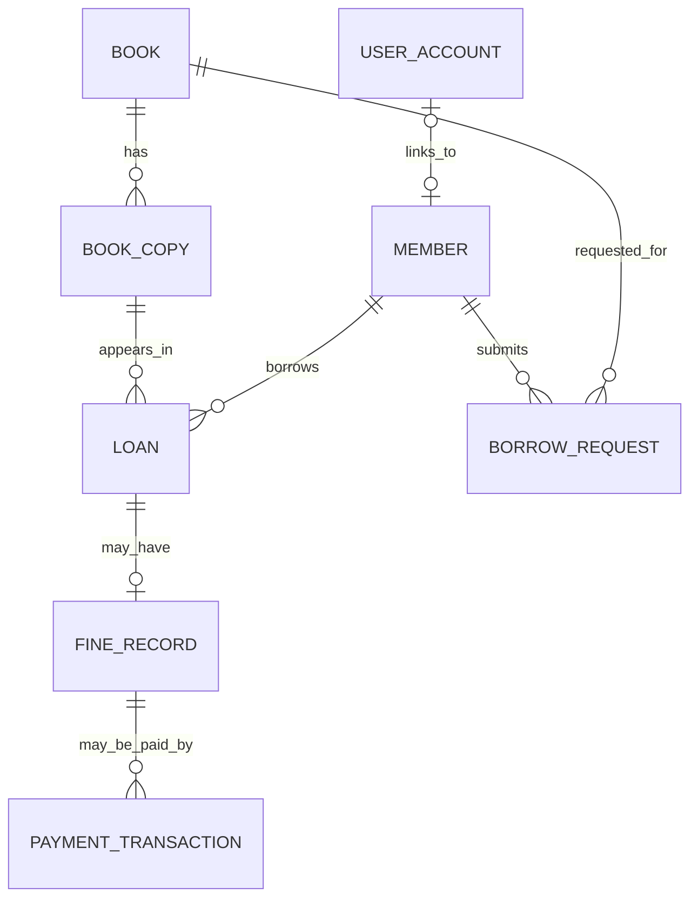

# Technical Design Document (TDD) — Library Management System

| Field | Value |
|---|---|
| Product | Library Management System |
| Version | MVP + Beta + Future Phase |
| Status | Proposed technical baseline |
| Related documents | `PRD.md`, `SRS.md` |

This document describes a straightforward implementation approach. Items marked **proposed** or **to confirm** are design choices, not claims that they have already been implemented.

## 1. Overview

- **MVP:** Build the catalogue, copy inventory, member records, issue/return workflows, and overdue list with React/TypeScript and FastAPI.
- **Beta:** Add accounts, Member/Librarian/Admin permissions, borrow requests, dashboards, secure deployment, and persistent production storage.
- **Future Phase:** Add optional fine records and hosted payment-provider integration only after payment policy and security requirements are approved.

## 2. Technology stack

| Layer | Choice | Purpose | Release |
|---|---|---|---|
| Frontend | React + TypeScript + Vite | Pages, forms, catalogue and circulation interface | MVP |
| Backend API | Python + FastAPI | REST endpoints, validation, OpenAPI docs | MVP |
| Request/response models | Pydantic | Validate API input and output | MVP |
| Data access | SQLAlchemy or SQLModel (choose one and use consistently) | Database models and queries | MVP |
| Local database | SQLite is a simple local-development option | Development and demos | MVP |
| Production database | Persistent PostgreSQL or another selected managed relational database | Reliable deployment storage | Beta |
| Authentication | FastAPI dependencies and a documented session/token approach | Login and protected APIs | Beta |
| Schema changes | Alembic if SQLAlchemy/SQLModel migrations are used | Versioned database migration | Beta |
| Hosting | Existing Vercel setup or a compatible host that supports the selected FastAPI/database arrangement | Deployment | Beta |
| Payment provider | Hosted checkout from a provider selected later | Secure payment collection for approved fines | Future Phase |

**Implementation rule:** Do not commit real secrets. Keep database URLs, auth secrets, and future payment-provider keys in environment variables or the deployment platform's secret store.

## 3. Architecture



The frontend displays data and collects input. The backend validates input, checks permissions, applies business rules, and saves changes. Database constraints and transactions protect book-copy/loan consistency.


### 3.1 Request flow — MVP




### 3.2 Borrow request flow — Beta



## 4. Proposed repository structure

```text
library-management-system/
├── docs/
│   ├── PRD.md
│   ├── SRS.md
│   └── TDD.md
├── frontend/
│   └── src/
│       ├── components/       # reusable UI elements
│       ├── pages/            # catalogue, member, librarian, admin screens
│       ├── services/         # API client and feature API functions
│       ├── types/            # TypeScript request/response types
│       ├── routes/           # navigation and Beta route guards
│       ├── App.tsx
│       └── main.tsx
├── backend/
│   ├── app/
│   │   ├── api/              # FastAPI routers
│   │   ├── schemas/          # Pydantic schemas
│   │   ├── models/           # database models
│   │   ├── services/         # circulation and permission rules
│   │   ├── repositories/     # database queries
│   │   ├── core/             # settings, auth, shared errors
│   │   └── main.py
│   ├── tests/
│   └── requirements.txt
├── .env.example
├── .gitignore
└── README.md
```

This is a target structure. Implement it gradually and keep it consistent with the actual repository.

## 5. Data model

### 5.1 MVP tables

| Entity | Important fields | Rules |
|---|---|---|
| `Book` | `id`, `title`, `author`, `isbn`, `publisher`, `category`, `description`, `is_archived` | `title` required; supplied ISBN/identifier should be unique |
| `BookCopy` | `id`, `book_id`, `copy_code`, `status`, `condition` | `copy_code` unique; a copy may have only one active loan |
| `Member` | `id`, `full_name`, `email/contact`, `member_type`, `is_active`, `created_at` | `member_type` is Student or Teacher; inactive members cannot receive new loans |
| `Loan` | `id`, `member_id`, `copy_id`, `issued_at`, `due_at`, `returned_at`, `status` | active loan requires valid member/copy; return closes the loan |

### 5.2 Beta additions

| Entity | Important fields | Rules |
|---|---|---|
| `UserAccount` | `id`, `email`, `password_hash`, `role`, `is_active`, `member_id?` | Role is Member/Librarian/Admin; hash only, never return password hash |
| `BorrowRequest` | `id`, `member_id`, `book_id`, `requested_at`, `status`, `decision_by`, `decision_at` | Pending request can be decided once; only Librarian/Admin can approve or reject |
| `BorrowingPolicy` | `id`, `member_type`, `max_active_loans`, `loan_days`, `renewal_limit?` | Values configured only after policy is agreed |
| `AuditEvent` | `id`, `actor_user_id`, `action`, `resource_type`, `resource_id`, `created_at` | Avoid storing secrets or unnecessary personal data |

### 5.3 Future Phase additions

| Entity | Important fields | Rules |
|---|---|---|
| `FineRecord` | `id`, `loan_id`, `amount`, `currency`, `reason`, `status`, `created_by`, `created_at` | Optional; requires an approved fine policy |
| `PaymentTransaction` | `id`, `fine_id`, `provider`, `provider_reference`, `amount`, `currency`, `status`, timestamps | Store provider reference and status only; never raw card details |

### 5.4 Relationships



The diagram includes Beta and Future Phase entities as planned. The actual MVP can begin with `Book`, `BookCopy`, `Member`, and `Loan`.

## 6. REST API design

Base path proposal: `/api`. All request and response bodies use JSON. FastAPI should publish the actual implemented schema through its OpenAPI documentation.

### 6.1 Core endpoints — MVP

| Method | Path | Purpose | Success |
|---|---|---|---|
| `GET` | `/api/health` | Check service health | `200` |
| `GET` | `/api/books` | List/search books | `200` |
| `POST` | `/api/books` | Create a book | `201` |
| `GET` | `/api/books/{book_id}` | View a book | `200` |
| `PATCH` | `/api/books/{book_id}` | Update/archive a book | `200` |
| `GET` | `/api/copies` | List copies and availability | `200` |
| `POST` | `/api/copies` | Add a physical copy | `201` |
| `PATCH` | `/api/copies/{copy_id}` | Update copy status/condition | `200` |
| `GET` | `/api/members` | List member records | `200` |
| `POST` | `/api/members` | Register a member record | `201` |
| `GET` | `/api/members/{member_id}` | View member record | `200` |
| `PATCH` | `/api/members/{member_id}` | Update or deactivate member | `200` |
| `GET` | `/api/loans` | List loans; support status/overdue filters | `200` |
| `POST` | `/api/loans` | Issue a copy by creating a loan | `201` |
| `POST` | `/api/loans/{loan_id}/return` | Record a return | `200` |

For a simple first cut, pagination and search may be basic. Book or member records referenced by loans should be archived/deactivated instead of hard-deleted.

### 6.2 Beta endpoints

| Method | Path | Who | Purpose |
|---|---|---|---|
| `POST` | `/api/auth/login` | Guest | Sign in |
| `POST` | `/api/auth/logout` | Authenticated user | Sign out |
| `GET` | `/api/users/me` | Authenticated user | View own profile |
| `PATCH` | `/api/users/me` | Authenticated user | Update permitted profile fields |
| `GET` | `/api/me/loans` | Member | View own loans/history |
| `POST` | `/api/borrow-requests` | Member | Submit a request |
| `GET` | `/api/borrow-requests` | Member/Librarian/Admin, scoped by role | View eligible requests |
| `POST` | `/api/borrow-requests/{id}/approve` | Librarian/Admin | Approve and proceed to issue workflow |
| `POST` | `/api/borrow-requests/{id}/reject` | Librarian/Admin | Reject a pending request |
| `GET` | `/api/admin/users` | Admin | List accounts |
| `PATCH` | `/api/admin/users/{id}` | Admin | Change permitted account status/role |
| `PATCH` | `/api/admin/borrowing-policy/{member_type}` | Admin | Change approved limits and loan duration |
| `GET` | `/api/reports/summary` | Librarian/Admin | View circulation summary |

Exact request and response schemas should be defined alongside each endpoint during implementation; the table is the proposed API surface, not a claim that endpoints already exist.

### 6.3 Future Phase endpoints

| Method | Path | Purpose |
|---|---|---|
| `GET` | `/api/me/fines` | View own fine records |
| `POST` | `/api/fines/{fine_id}/checkout` | Create a provider checkout session for an eligible fine |
| `POST` | `/api/payments/provider-webhook` | Receive and verify provider events server-side |
| `GET` | `/api/me/payments` | View own payment history |

Webhook signature validation, idempotency keys, amount/currency verification, and provider-side status verification are required before a payment integration goes live.

## 7. State and data integrity rules

1. An individual copy can have at most one active loan.
2. Only a copy with status Available may be issued.
3. Only an active member may receive a loan.
4. Due date must not precede issue date.
5. Returning a loan twice must be rejected without changing existing records.
6. A loan return and copy-status update must be saved atomically in a transaction.
7. Book/member records with loan history should be archived/deactivated, not physically deleted.
8. In Beta, each protected endpoint checks the caller's role and ownership on the backend.
9. A borrow request is not an issued loan. The loan is created only when the librarian completes the issue workflow.
10. In the Future Phase, a payment is successful only after verified provider confirmation; repeated callbacks must be safe to process more than once.

## 8. Authentication and authorization — Beta

### 8.1 Role design

Top-level roles are exactly `member`, `librarian`, and `admin`. Student/Teacher is a member subtype stored on the Member profile, not a separate role.

### 8.2 Enforcement approach

- Create reusable FastAPI dependencies for authenticated user, Librarian, and Admin.
- Check resource ownership for Member profile, loans, requests, fines, and payment history.
- Keep role assignment restricted to Admin and validate requested roles against the allowed list.
- Treat React route guards as user experience only; the API remains authoritative.
- Audit role changes and staff decisions where appropriate.

## 9. Security and configuration

| Area | Design |
|---|---|
| Credentials | Store salted password hashes using a standard maintained library; never store plain passwords |
| Secrets | Database/auth/payment secrets live in environment variables or secret manager; never commit to Git |
| Transport | Use HTTPS in deployed environments |
| Permissions | Server-side checks on every protected endpoint |
| Input | Validate requests with Pydantic; use parameterized ORM/database operations |
| Errors | Return safe error messages; keep detailed diagnostic logs server-side |
| Sessions | Select an appropriate session/token strategy and document expiry/revocation behavior before Beta release |
| CORS | Restrict to actual frontend origins when frontend and API use different origins |
| Payment | Future phase only; hosted checkout, signed webhooks, idempotent processing, no raw payment credentials |

## 10. Testing strategy

| Test level | Examples | Release |
|---|---|---|
| Unit tests | Due-date/overdue logic, borrowing-limit checks, allowed state transitions | MVP/Beta |
| API tests | Book CRUD, member CRUD, issue, return, invalid IDs, validation errors | MVP |
| Integrity tests | Duplicate active issue is rejected; return updates loan and copy together | MVP |
| Authorization tests | Member cannot manage catalogue; one Member cannot read another's loans; only Admin manages roles | Beta |
| Workflow tests | Borrow request → decision → issue → return | Beta |
| Payment integration tests | Verified callback, duplicate callback, failed/cancelled transaction, amount mismatch | Future Phase |

## 11. Deployment and milestones

### MVP — Midterm

1. Confirm the core data model and local database connection.
2. Implement book and copy endpoints.
3. Implement member records and loan issue/return operations.
4. Connect React forms and tables to FastAPI.
5. Verify health/docs, validation, and core workflows locally.

### Beta — Final

1. Add authentication and account-to-member linking.
2. Add server-side RBAC and ownership checks.
3. Implement borrow requests, librarian decision tools, and member history.
4. Implement Admin account/policy management and basic reports.
5. Configure persistent production database, HTTPS, secrets, health checks, and deployment process.
6. Run acceptance and authorization tests before release.

### Future Phase — Payments

1. Confirm fine policy, currency, provider, refunds, and support procedures.
2. Design fine and payment records and migrations.
3. Add hosted checkout and server-side provider verification.
4. Test duplicate callbacks, failed payments, reconciliation, and receipt generation.
5. Complete a security review before enabling the feature for real users.

## 12. Risks and mitigations

| Risk | Mitigation |
|---|---|
| Duplicate issue of a single copy | Use database constraints/transaction and check for an active loan |
| Copy status and loan status become inconsistent | Update both within one transaction and test rollback behavior |
| Member sees another member's records | Add ownership checks to every member-specific API endpoint and test them |
| Book records are lost due to hard deletion | Archive books and deactivate members that have history |
| Deployed app loses data on restart | Select a persistent database for Beta; do not rely on serverless local files |
| Requirements grow beyond the release plan | Keep features assigned to MVP, Beta, or Future Phase and review changes before implementation |
| Payment fraud or false confirmation | Future-phase provider verification, signed webhooks, idempotency, reconciliation, and no raw card storage |

## 13. Decisions to finalize

- Choose SQLAlchemy or SQLModel and document the final schema/migration approach.
- Select the production database and hosting arrangement compatible with the existing Vercel setup.
- Agree on loan durations, maximum loans, renewals, and reservation rules.
- Decide account creation and recovery process.
- Confirm whether fine records are needed at all.
- If payments are later approved, select a provider and define supported currencies, refunds, fee policy, and reconciliation ownership.
